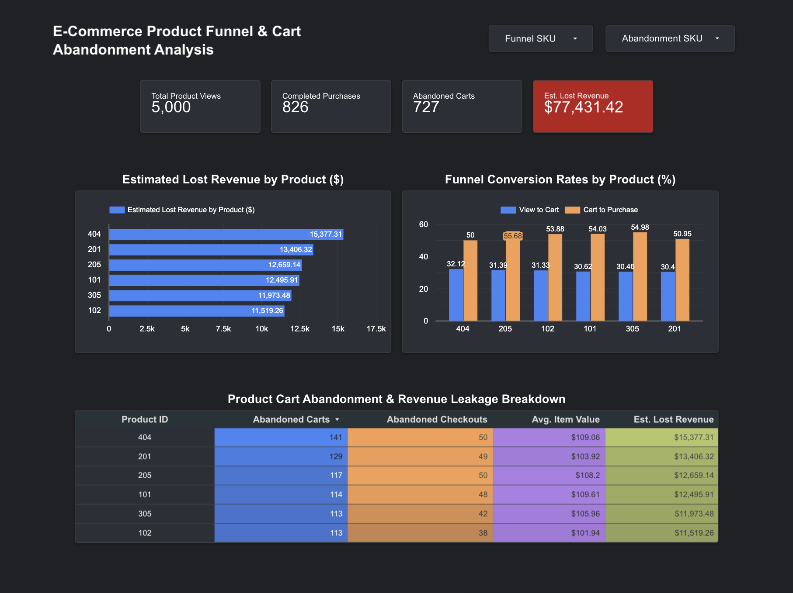

# E-Commerce Product Funnel & Cart Abandonment Analysis (SQL / BigQuery)

🔗 **[View Live Interactive Dashboard (Looker Studio)](https://datastudio.google.com/reporting/d4471d89-71d4-4c20-8902-5496d9ca58a2)**

---

## 📌 Project Overview
An end-to-end SQL and BI product analytics project analyzing **5,000+ user clickstream events** across **6 e-commerce SKUs** (`101`, `102`, `201`, `205`, `305`, `404`) in **Google BigQuery** and **Looker Studio**. While overall traffic was strong, conversion varied noticeably across product lines. This analysis isolates product-level conversion bottlenecks, quantifies the exact dollar revenue left on the table from cart and checkout abandonment, and delivers an interactive dashboard for stakeholder exploration.

---

## 🎯 Business Questions
1. **Product Funnel Efficiency:** How effectively does each product convert shoppers from `page_view` → `add_to_cart` → `checkout_start` → `purchase`?
2. **Revenue Leakage:** Which products lose the most potential revenue to abandoned carts and abandoned checkouts?
3. **Recovery Strategy:** Which user segments and product pages should merchandising and marketing teams prioritize first?

---

## 🛠️ Tools & SQL Techniques Used
* **Google BigQuery (SQL):**
  * **Common Table Expressions (`WITH`):** Modularized multi-step aggregations for readability and maintainability.
  * **Conditional Aggregation (`COUNT(DISTINCT CASE WHEN ...)` & `MAX(CASE WHEN ...)`):** Deduplicated user events per stage and mapped each user-product journey to its furthest funnel milestone.
  * **Safe Division (`SAFE_DIVIDE`):** Prevented division-by-zero errors when computing stage-to-stage conversion percentages.
  * **Table Joins (`JOIN`):** Combined user-level abandonment counts with SKU-level average order values (`AVG(amount)`) to estimate lost revenue.
* **Google Looker Studio (Data Studio):** Built an interactive executive dashboard featuring KPI scorecards, dedicated **Funnel SKU** and **Abandonment SKU** filter controls, conversion comparison charts, and conditional heatmap tables.

---

## 📊 Key Findings & Results

### 1. Product-Level Conversion Funnel

| Product ID | Views | Add to Cart | Purchases | View-to-Cart (%) | Cart-to-Purchase (%) | Overall Conversion (%) |
| :--- | :---: | :---: | :---: | :---: | :---: | :---: |
| **205** | 841 | 264 | 147 | 31.39% | **55.68%** | **17.48%** |
| **102** | 782 | 245 | 132 | 31.33% | 53.88% | 16.88% |
| **305** | 824 | 251 | 138 | 30.46% | 54.98% | 16.75% |
| **101** | 810 | 248 | 134 | 30.62% | 54.03% | 16.54% |
| **404** | **878** | **282** | 141 | **32.12%** | 50.00% | 16.06% |
| **201** | 865 | 263 | 134 | 30.40% | 50.95% | 15.49% |

* **Top Converter (`Product 205`):** Leads the catalog with **147 purchases** and a **17.48%** overall conversion rate.
* **Highest Interest, Highest Drop-Off (`Product 404`):** Draws the most views (**878**) and highest add-to-cart rate (**32.12%**), but loses **50.00%** of shoppers between cart addition and purchase.

---

### 2. Cart Abandonment & Lost Revenue Valuation
Across all 6 products, **727 carts were abandoned** (including **277 high-intent users** who initiated checkout), representing **`$77,431.42`** in uncaptured revenue.

| Product ID | Abandoned Carts | Abandoned Checkouts | Avg Item Value ($) | Estimated Lost Revenue ($) |
| :--- | :---: | :---: | :---: | :---: |
| **404** | **141** | **50** | $109.06 | **$15,377.31** |
| **201** | 129 | 49 | $103.92 | **$13,406.32** |
| **205** | 117 | 50 | $108.20 | $12,659.14 |
| **101** | 114 | 48 | **$109.61** | $12,495.91 |
| **305** | 113 | 42 | $105.96 | $11,973.48 |
| **102** | 113 | 38 | $101.94 | $11,519.26 |
| **Total** | **727** | **277** | — | **$77,431.42** |

* **37.2% of all lost revenue (`$28,783.63`)** comes from just two SKUs: **Product 404** (`$15,377.31`) and **Product 201** (`$13,406.32`).

---

## 💡 Strategic Recommendations
1. **Audit Product `404` & `201` Pages for Checkout Friction:** Both SKUs generate strong top-of-funnel demand (`878` and `865` views) but suffer steep post-cart drop-offs (`50.0%` and `50.95%` completion). Review shipping fees, tax calculations, and product page clarity on these two listings.
2. **Launch Automated Checkout-Abandonment Emails:** Target the **277 high-intent users** who reached `checkout_start` without purchasing with a 1-hour automated follow-up email, prioritizing high-ticket items like **Product 101** (`$109.61` AOV) and **Product 404** (`$109.06` AOV).
3. **Standardize Product Page Merchandising Around `Product 205`:** Use Product `205`'s page layout, value proposition, and trust signals as the template to lift conversion on underperforming SKUs.

---

## 📂 Repository Structure
* `dashboard.png` — Preview of the interactive Looker Studio executive dashboard.
* `queries/product_funnel_analysis.sql` — BigQuery SQL scripts for product catalog pricing, SKU conversion rates, and cart abandonment revenue estimates.
* `data/product_conversion_funnel.csv` — Aggregated conversion rate metrics by product SKU.
* `data/product_cart_abandonment.csv` — Cart abandonment counts and estimated uncaptured revenue by product SKU.
